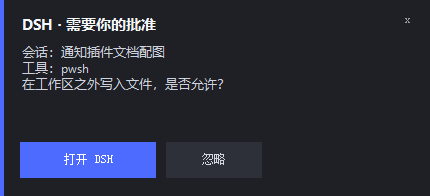

# dsh-notify

[](https://github.com/WangShuangTong/dsh-notify/actions/workflows/ci.yml)

Desktop notifications for [DeepSeek Harness](https://github.com/deepseek-ai/deepseek-harness) (`dsh`).
When DSH needs your approval or answer, finishes a turn, or fails while you are
working in another application (IDEA, WeChat, a meeting…), a topmost card appears
at the bottom-right of the screen. Clicking **Open DSH** brings DSH to the
foreground and switches to the related session.



**English** | [中文](#中文说明)

> Early preview. Tested with DSH Desktop `0.2.2-alpha.2` on Windows 11.
> The card channel is Windows-only; the Web client falls back to the browser
> Notification API.

## English quickstart

Requirements: DSH Desktop on Windows 10/11. `lib/` is committed, so a GitHub
install needs no build step.

1. In DSH Desktop open **Settings → Plugins → Add plugin**.
2. Enter the GitHub spec:

   ```text
   github:WangShuangTong/dsh-notify
   ```

   A local checkout also works (absolute path): `C:\path\to\dsh-notify`, or the
   packed `dsh-notify-0.1.0.tgz`.
3. Install, enable the bundle, and restart DSH Desktop when prompted.
4. After restart a self-test card appears in the bottom-right corner. Click it to
   verify focus handling.

A self-contained tarball is attached to each
[release](https://github.com/WangShuangTong/dsh-notify/releases) for offline or
local-path installation.

Configuration lives in the profile's `cordis.patch.yml`; the defaults are listed
below. The notification card stays for 60 s for questions and 15 s for completed
turns (configurable, `0` keeps it until dismissed).

### Why not a Windows toast?

In the tested developer Desktop, Electron page notifications were displayed by
Windows but their click activation never reached the app, SnoreToast 0.7.0 click
callbacks were unreliable, and Windows PowerShell 5.1 cannot subscribe to WinRT
toast activation. The self-drawn topmost card is the only channel where display,
click handling, and window focus all worked. Trade-off: the card does not appear
in the Windows notification center.

### Community

Repository topic: `dsh-plugin` (used by the DSH plugin ecosystem for discovery).

> The npm package name `dsh-notify` is already used by an unrelated package.
> Install this plugin from GitHub or from a local path/tarball, not from npm.

---

## 中文说明

当你切到 IDEA、微信等其它程序时，DSH 需要你处理（提问 / 审批 / 计划确认）、一轮任务完成或 Agent 报错，会在屏幕右下角弹出一个置顶通知卡；点击「打开 DSH」会把 DSH 窗口带到前台，并切到对应会话。

### 为什么是自绘置顶窗，而不是 Windows Toast

在当前实测环境（源码启动的 DSH Desktop，Windows 11）里：

- Electron 页面 Notification：能显示、能进通知中心，但点击不会路由回应用，拿不到点击回调；
- SnoreToast / node-notifier 0.7.0：点击回调不稳定；
- PowerShell 原生 Toast：能显示，但 Windows PowerShell 5.1 无法订阅 WinRT 激活事件，拿不到点击。

自绘置顶窗（Host 侧 PowerShell WinForms）的显示、点击、聚焦链路均已实测通过，因此作为默认通道。代价是它不会进入 Windows 通知中心。

### 功能

- DSH 不在前台时：
  - 提问 / 审批 / 计划确认：立即弹窗，带会话名、问题内容或工具/原因；
  - 一轮任务完成：弹窗，带会话名；同一时刻多个会话完成会合并成一条；
  - Agent 报错：弹窗，带错误摘要。
- 点击「打开 DSH」：置前 DSH 窗口 + 切到对应会话。
- DSH 在前台时不打扰；子代理会话不通知；同一请求不会重复弹。
- Web 版（浏览器打开 DSH）：使用浏览器原生通知，点击切会话。
- 首次加载弹一条自检通知，确认通道可用。

### 安装

**方式一：GitHub 安装（推荐，不需要本地构建）**

1. DSH Desktop → 设置 → 插件 → **Add plugin**；
2. 填入：

   ```text
   github:WangShuangTong/dsh-notify
   ```

3. Install → 安装完成后启用组合包（Enable）；
4. 若提示需要重启，从托盘退出 Desktop 后重新启动。

每个 [Release](https://github.com/WangShuangTong/dsh-notify/releases) 都附带自包含
tarball，可离线安装或用 Add plugin 选择本地 tarball。

`lib/` 是构建产物且已提交，所以 GitHub 安装不需要 `pnpm install`/构建步骤。

**方式二：本地目录 / tarball**

```powershell
git clone https://github.com/WangShuangTong/dsh-notify.git
cd dsh-notify
pnpm install
pnpm run build
pnpm pack        # 可选：生成自包含 tarball dsh-notify-0.1.0.tgz
```

在 Add plugin 中填绝对路径：目录（安装成 `link:`，改动即时生效）或 tarball
（自包含快照，改代码后需重新打包并重装）。

**方式三：手工等价安装（desktop profile 被应用独占时的兜底）**

编辑 `%USERPROFILE%\.dsh\profiles\desktop\package.json`：

- `dependencies` 增加 `"dsh-notify": "link:C:/path/to/dsh-notify"`（或 tarball 的 `file:` 路径）；
- `dsh.profile.bundles` 追加 `"dsh-notify"`；

然后在 profile 目录执行 `pnpm install --ignore-scripts`，并重启 Desktop。

> 安装前建议备份 profile manifest。`desktop` profile 由 Electron 应用独占管理，
> 命令行 `dsh plugin --profile desktop add` 会被拒绝；请优先使用插件管理页。

### 配置

默认值写在 `cordis.patch.yml`。可在 profile 的 `cordis.patch.yml` 中按 `id: dsh-notify` 覆盖（patch 会整体替换 config，需写全要保留的键）：

```yaml
- id: dsh-notify
  config:
    notifyOnAsk: true
    notifyOnDone: true
    notifyOnError: true
    sound: true
    onlyWhenUnfocused: true
    announce: true
    askAutoCloseMs: 60000
    doneAutoCloseMs: 15000
    transport: auto
    debug: false
```

| 键 | 默认 | 说明 |
|---|---|---|
| `notifyOnAsk` | `true` | 提问 / 审批 / 计划确认提醒 |
| `notifyOnDone` | `true` | 一轮任务完成提醒 |
| `notifyOnError` | `true` | Agent 报错提醒 |
| `sound` | `true` | 弹窗出现时播放系统提示音 |
| `onlyWhenUnfocused` | `true` | 仅 DSH 不在前台时提醒 |
| `announce` | `true` | 首次加载弹自检通知（每个版本一次） |
| `askAutoCloseMs` | `60000` | 提问类弹窗停留时长，`0` = 直到点击/忽略 |
| `doneAutoCloseMs` | `15000` | 完成/错误弹窗停留时长 |
| `transport` | `auto` | `auto` / `popup` / `browser`；Windows Desktop 自动用 `popup` |
| `debug` | `false` | 暴露 `globalThis.__DSH_NOTIFY_DEBUG__` 调试钩子 |

### 排障

- 浏览器控制台（Desktop 中按 F12）过滤 `[dsh-notify]`；启动终端里应有 `[dsh-notify] host ready`。
- `globalThis.__DSH_NOTIFY_LOADED__` 表示客户端插件已加载。
- `debug: true` 时可用 `__DSH_NOTIFY_DEBUG__.simulate('ask' | 'done' | 'error' | 'self-test', { sessionId, title, question })` 手动触发弹窗。
- 弹窗若没有出现：确认 DSH 窗口确实不在前台（`document.hasFocus()` 为 false），并查看 Host 日志。

### 已知限制

- 弹窗不是系统通知，不进入 Windows 通知中心。
- 默认出现在主屏右下角；多显示器跟随窗口位置尚未实现。
- 仅 Windows 使用自绘弹窗；其它平台自动退回浏览器通知。
- Web 多标签页可能重复提醒。
- 点击「打开 DSH」依赖 Host 能定位 Electron 主进程窗口；窗口最小化时会恢复，隐藏到托盘时会尝试恢复，若系统拒绝则请点托盘图标。

### 开发

```powershell
pnpm install
pnpm run typecheck
pnpm run test
pnpm run build
```

- `src/index.ts`：Host 半（配置注入、路由、弹窗进程管理、激活记录）。
- `src/client/`：Client 半（状态检测、门控、文案、传输、激活轮询）。
- `src/popup.ps1`：通知卡 sidecar（Windows PowerShell 5.1，纯 ASCII，文本经 Base64 传入）。
- `lib/`：构建产物；**需要提交**，GitHub 安装依赖它。
- 文档截图：`src/popup.ps1` 支持 `-CapturePath <png>`，在卡片绘制完成后把自身渲染成图片并退出（仅文档/测试用，正常通知不传该参数）。

### License

MIT
